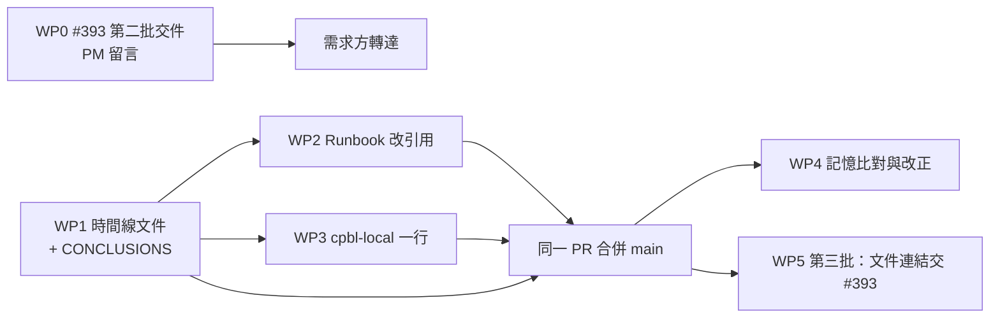

# #400 規劃：排程時間點檢查、優化項目與排程時間線文件

- 卡：[#400](https://github.com/ruan6047/cpbl-analytics/issues/400)，階段＝規劃，規劃者（claude-opus-5-5），2026-10-31
- 規劃輸入（只用這些）：
  - Issue body 五章節（驗收 1–5、限制）
  - 需求方裁定 [6543469775](https://github.com/ruan6047/cpbl-analytics/issues/400#issuecomment-6543469775)（五項）、[6543512975](https://github.com/ruan6047/cpbl-analytics/issues/400#issuecomment-6543512975)（需求確認）、[6543555817](https://github.com/ruan6047/cpbl-analytics/issues/400#issuecomment-6543555817)（追加驗收 5）
  - 研究 `R1_schedule_timing.md`、`R1_measurements.md`、`R2_blocked_tasks.md`（固定版本 `10148f5f`，以下簡稱 R1／R2）
  - 已交 #393 第一批 [6543772679](https://github.com/ruan6047/cpbl-analytics/issues/393#issuecomment-6543772679)
- 相連卡內容只用於判斷歸屬，不是規劃輸入：#393 規劃完成卡 [6498071321](https://github.com/ruan6047/cpbl-analytics/issues/393#issuecomment-6498071321)、#393 PLAN（需求方本機 `~/.wf-evidence/cpbl-analytics/393/PLAN.md`，sha256 `7d2c1234…d3c1`，只讀 §2.3 排程器、§4 工作包表、§5 住宅 IP 段）、#393 休季常設租用 [6543597135](https://github.com/ruan6047/cpbl-analytics/issues/393#issuecomment-6543597135)。
- 本檔只是規劃，沒有修改任何記憶、`.wf/`、Runbook、registry、launchd 或 DB。

標記：【事實】直接讀到或量到；【推論】由事實推得；【未量測】沒有證據，不給數值。

---

## 0. 一句話

這張卡的成果是**文件**：排程時刻只住在 `scripts/schedule-registry.json`。新增的時間線文件寫「每個排程服務什麼事件、為什麼選這個時刻、它占用哪些資源」，Runbook、`.wf/cpbl-local.md` 與 Claude 記憶只引用這份文件。優化建議中，**沒有一項建議現在就改 Mac 的 launchd**：多數交給 #393 的新設計；能立即減輕「任務被排程卡住」的部分，放在時間線文件裡，不動排程本身。

---

## 1. 方案比較與選定

### 1.1 時間線文件怎麼「引用 registry、不另寫數值」（規劃要產出第 3 項）

| 方案 | 做法 | 優點 | 代價 |
|---|---|---|---|
| **A（推薦）欄位路徑引用＋查詢指令** | 文件不寫任何排程時刻、間隔或期限的數值。每個排程用 registry 欄位路徑指出時刻所在，例如 `jobs[label=com.cpbl.scrape-daily].cadence`、`.alert.deadline`；registry 以外的程式內時窗則引用常數名稱，例如 `src/cpbl/ingest/postseason_evening.py::DAILY_GUARD`。文件開頭附一段唯讀指令，用來印出現值 | 沒有第二份數值，不會漂移；#393 搬遷後只改 registry 或常數，文件文字不必跟著改；不新增工具 | 讀者要跑一行指令或打開 registry，才看得到實際鐘點 |
| B 由腳本產生區塊 | 新增腳本，把 registry 渲染成表格，寫進文件中兩個標記之間；pytest 檢查文件與 registry 一致 | 讀文件就看得到鐘點 | 文件裡仍然出現一份數值，只是改成機器產生，與限制「不另外寫一份數值」字面衝突；還要新增腳本與測試，這屬於需求沒有要求的機制（規劃者 §2、§4） |

**不採用 B 的理由**：限制原文是「文件不另外寫一份數值」，B 只改了數值的來源，仍然是第二份。B 新增的腳本與測試，要防的是時刻漂移風險，而方案 A 從結構上就沒有這個風險。

方案 A 的「查現值」指令：只讀 registry，不執行 `cpbl-*` 或 `scripts/*.sh`。例：

```bash
python3 -I -c "import json;[print(j['label'],j['cadence'],j.get('alert',{}).get('deadline',''),j.get('evening_alert',{}).get('fallback_deadline','')) for j in json.load(open('scripts/schedule-registry.json'))['jobs']]"
```

允許與不允許出現在時間線文件裡的數字：
- ⛔ 不寫：排程的觸發時刻、間隔、期限、程式內時窗的數值，例如 `HH:MM`、「每 N 秒」、「+5h」。
- ✅ 可寫：研究量到的觀測值，例如「終場後數分鐘」「16/69 次」，但必須附 R1／R2 的固定版本連結。這些數字是歷史證據，不是排程設定。

### 1.2 驗收 1 的結論放哪裡

| 方案 | 做法 | 取捨 |
|---|---|---|
| **甲（採用）獨立快照檔** | `docs/research/SCHED-TIMING-400/CONCLUSIONS.md`：2026 季 Mac 現行排程的合理性結論，賽季、休季分開，每個排程一列，證據引用 R1 節次。時間線文件只連結它 | 結論是針對 Mac 現況、有日期的快照；#393 搬遷後改寫時間線文件時，不會連帶刪掉或留住過期的證據 |
| 乙 放進時間線文件附錄 | 同內容寫成時間線文件的附錄 | 時間線文件要長期維護、隨 #393 改寫，快照放進去不是變成過期內容，就是改寫時被刪掉。不採用 |

### 1.3 Runbook 的「排程段」範圍

需求原文是 Runbook 的「排程段改為引用時間線文件」，限制則寫「都不再自己寫時刻」。Runbook 裡的時刻有兩類（下方 §5.3 逐行列出）：

- **第一類：launchd 觸發時刻與 healthchecks 期限**。這兩種都已登記在 registry，改成引用時間線文件。本規劃採用。
- **第二類：程式內行為時窗**，例如晚間鏈「一晚」的界線、讓位每日鏈的時段、先發的前一天時點、01:00 的 missed 判定，都定義在 `postseason_evening.py`／`alert_watch.py` 的常數裡，不在 registry。
  - 推薦：Runbook §10 保留這類時窗原文，因為它們是行為規格，不是排程時刻；時間線文件的〈隱含耦合〉一節列出這些常數名稱。
  - 另一個選項：連第二類也改成引用常數名稱。代價是 Runbook §10 變得難讀，而且改的行數最多，最容易跟 #393 WP8 改 Runbook 撞在一起。
  - **待需求方裁定**（§9 D3）。

---

## 2. 優化項目清單（驗收 2）

「現在就改 Mac」只限「現在有人受害，而且 #393 短期上不了線」的項目。#393 的期限是 2027 熱身賽前，WP7 切換要等 WP6 通過，所以短期確實上不了線【事實，#393 body 驗收 2、5，PLAN §4】。現在是休季，多數賽季性質的受害目前不會發生。**每一項都待需求方逐項裁定。**

歸屬分四類：
- **本卡文件**：寫進本卡的時間線文件，不動排程。
- **協調規則**：共同主 PM 的窗口規則，本卡只提供事實。
- **交 #393**：寫進 #393 的新設計。
- **現在就改 Mac**：本規劃沒有推薦任何一項，只列出選項。

### O1　任務不必等排程：寫明等價的手動操作與「真正需要等」的條件（本卡文件）
- **誰受害**：等時刻型 17 例中有 16 例在等 10:10 每日鏈（R2 §3.2-1），休季仍然發生（B14 10-29、B15／B16 10-28）。需求方至少 9 次質疑或推翻這類等待（R2 §3.3）。
- **怎麼改**：時間線文件新增一節〈任務要不要等排程〉，內容如下。
  1. 每個排程的工作有沒有手動等價入口。只引用 Runbook 現有的手動 fallback 與 `kickstart` 寫法，不新增指令。
  2. 手動觸發仍要遵守的事：資源租用、爬蟲不連續重跑紅線、日型閘門。例如 skip 日手動觸發每日鏈也只會跳過。
  3. 只有以下情形才需要等排程自然執行：驗收本身就是「排程自然執行後仍然正確」，或者只有排程的鏈會套用的步驟（例如 migration 由鏈套用時）。
  4. 引用需求方的原則「不要等排程時間」（[#344 6360646281](https://github.com/ruan6047/cpbl-analytics/issues/344#issuecomment-6360646281)）。
- **預估效果**：【未量測】沒有數據能說明這一節能減少多少等待；只能說它涵蓋 R2 等時刻型中「以手動觸發即可取代」的那一類，例如 B3。
- 不碰 launchd、不碰 registry。

### O2　每個排程的資源足跡與「正在忙」的實際訊號（本卡文件）
- **誰受害**：搶資源型的實際撞上 A1–A5、窗口被框住 A6–A14（R2 §2.2）。#393 休季租用的前置核對要求「晚間鏈醒來、quiet 退出後再核一次」（6543597135），#382 WP1 探測則被 `other_www_process` 閘門中止（A2）。
- **怎麼改**：時間線文件為每個排程列出它會碰哪些資源：是否取 refresh lock、是否連 DB、是否連 www、是否連 stats，以及判斷它正在忙的訊號（lock 檔、狀態檔 `state`）。資料來源是 R1 §8 與 R1 §4.5。例如晚間鏈 quiet 時不連 DB、不連 stats、不取鎖；watchdog 與 alert-watch 都不取鎖。
- **預估效果**：【未量測】。
- 不碰排程。

### O3　共同主 PM 窗口規則中的「21:00–21:15」（協調規則，待裁定）
- **誰受害**：A6、A7 因此改天部署，A8 則被需求方推翻（R2 §2.2）。
- **事實**：
  - 這一時段排定的只有 watchdog，而 watchdog 不取鎖、不連 www（R1 §8）。
  - R2 §4 寫明「21:00–21:15 具體在避哪個排程，沒有查證」。
  - 「10:10–10:30」的實際結束時刻從 10:10:05（skip 日）到 11:38 不等（R2 §3.2-1）。
- **怎麼改（選項）**：
  - (a) 維持。
  - (b) 請共同主 PM 先說明這段時間在避什麼，再決定是否刪除。
  - (c) 窗口改以 O2 的實際訊號（lock 檔、狀態檔）判斷，不再用固定時段。
- 這是共同主 PM 的協調規則，不是本卡成果。本卡只在時間線文件寫事實，在確認畫面提出選項（[[common-pm-cannot-change-requester-constraints]] 的界線）。⛔ 不替需求方決定。

### O4　休季晚間鏈的空喚醒（推薦本卡文件；Mac 選項觸及 #365，待裁定）
- **誰受害**：
  - Mac 整天醒著時一天喚醒 288 次，每次都是 `plan → quiet`（R1 §4.5）。
  - 前置核對會誤命中這個短暫程序，見 O2 的 #393 租用案例。
  - 單次 quiet 的耗時與 CPU 成本沒有量（R1 G8）。
- **選項**：
  - (a) 推薦：只做 O2 的文件說明，指出 quiet 不取鎖、不連 www／DB，前置核對以 lock 檔為準。
  - (b) 休季時 bootout 晚間鏈：⚠️ **觸及 #365 裁定**「休季靠動作條件靜默、不靠 bootout」（registry `expected_installed_reason`），也會改到 launchd。
  - (c) 交 #393：新排程器決定休季要不要排這個條目。#393 已定「承接 #391 休賽閘門」，本卡只標出差異：閘門放在動作條件，還是放在排程層。
- **預估效果**：(a)【未量測】；(b) 每天少 288 次喚醒（R1〔M11〕），成本節省【未量測】。

### O5　每日鏈 10:10 時刻的實際約束與隱含耦合（交 #393）
- **事實**：
  - 10:10 不受官方發布時間綁住，主要資料在終場後 30 分鐘內就齊了（R1 §3 E2／E3、§4.1）。
  - 實際的約束有三個：Mac 醒著、本機 DB 容器開著、Runbook 的「時段紅線：勿改到深夜／凌晨」（官網深夜加嚴）。
- **新增事實（本規劃窄讀程式碼）**：每日鏈的時刻至少和以下幾處耦合，搬遷或改時刻時必須一起改：
  - plist 的 `StartCalendarInterval`
  - registry 的 `cadence`、`alert.schedule`、`alert.deadline`
  - healthchecks 服務端排程（registry note 已載明）
  - `postseason_evening.DAILY_GUARD`（讓位每日鏈的時段）
  - `alert_watch.NIGHT_START`
- **交 #393 的建議**：
  - 搬到 VPS 後，「Mac 醒著」這個約束消失。
  - www 改由樹莓派走住宅 IP，深夜紅線仍然適用。
  - stats 不受這條紅線約束。
  - 新排程若改時刻，耦合清單要在同一個變更裡一起改。
- **預估效果**：避免時刻只搬了一半；【未量測】。

### O6　每日鏈完成時間與 11:00 期限（交 #393）
- **事實**：例行賽有賽日 69 次中有 16 次晚於 11:00 完成，原因（睡眠或反爬退避）在 10-24 以前無法區分（R1 §4.1、G5）。
- **現況**：休季每日鏈很短，例如 skip 日只跑 2 秒，目前沒有人受害。
- **建議**：
  - 交 #393：VPS 上沒有睡眠問題，期限依 #393 WP2 量到的耗時重新決定。
  - Mac 不改。
  - 只調 healthchecks grace 屬於需求方在 SaaS 端的設定，列為選項，不推薦數值。
- **預估效果**：【未量測】。

### O7　週一 box 週跑撞鎖整週跳過（交 #393；Mac 選項觸及紅線，待裁定）
- **事實**：
  - 6 個共同週一中撞鎖 1 次（09-28），成因是逐球週跑被睡眠拉長，不是時刻表本身重疊（R1 §5）。
  - 11 次觸發成功 7 次，失敗多半是 DB 容器沒開，與時刻無關。
  - R2 查無任務因它被卡住（R2 §3.2-5）。
  - 休季兩軍收官後兩個週跑都會跳過（R1 §4.2，程式碼推論）。
- **選項**：
  - (a) 推薦：Mac 不改，交 #393（VPS 不睡眠，撞鎖成因消失）。
  - (b) 拉大兩個週跑的間隔：沒有證據支持特定數值。
  - (c) 撞鎖後重試：⚠️ **違反 `weekly-box-revisions.sh` 檔頭的「忙碌即跳過、不重試」紅線**（HiNet 節流），只列為選項。
- **預估效果**：(a) 未量測；(b)、(c) 能避免的機率只有 1/6 這一個樣本可參考。

### O8　晚間告警期限「最晚開賽＋5h」（交 #393／#392，開季前）
- **事實**：一軍 A 有 1/357 場時長超過 300 分；fallback 23:35 對照最晚終場 23:02，還有 33 分餘裕（R1 §4.5）。
- **現況**：休季沒有比賽，目前沒有人受害。
- **選項**：維持，或加長。數值需要經過討論，本規劃不給。
- 開季切回屬於 #392，搬遷形態屬於 #393；本卡只交證據。

### O9　alert-watch 的晚間告警流程在賽季從未實際啟動（交 #393）
- **事實**：log 從 10-28 才開始，evening 段的武裝、成功、halted 從未出現（R1 §4.6、G6）。
- **交 #393 的差異註記**：#393 驗收 4 已規定 healthchecks 四個 check 要做故障注入。本卡只提醒一件事：注入要涵蓋 evening check 的「武裝、改正期限」路徑，因為 Mac 端從未在真實賽季跑過這條路徑。#393 已定的部分不要求改動。

### O10　晚間鏈 5 分鐘間隔（交 #393）
- **事實**：C 戰在終場後 +5～+8 分完成同步，輪詢間隔是延遲的主要組成（R1 §4.5）。乾淨樣本 n=4；A 夜沒有量測（G2）。
- **建議**：
  - VPS 上的間隔由 #393 決定。
  - 縮短間隔會增加 stats 請求量，效益【未量測】。
  - Mac 不改。

### O11　每日鏈是 migration、建置、同步的唯一執行者，所以任務要等下一個週期（交 #393）
- **誰受害**：同 O1，例如 B3–B8、B11、B14。
- **交 #393 的建議**：新排程器提供同一 job 的按需觸發。按需觸發與排程共用同一把鎖、同一個閘門，任務就不必等下一個週期。#393 已採用 supercronic 常駐容器（PLAN §2.3），本卡只提出這項需求，不設計做法。
- **預估效果**：【未量測】。

### O12　watchdog 21:10 與 healthchecks `daily` 的職責重疊（交 #393）
- **事實**：
  - watchdog 判的是週期，21:10 決定的是「異常當天多久被看見」（R1 §4.4）。
  - 08-25～09-07 每日鏈連續失敗那段期間，#358 的 `daily` 檢查還沒上線；現在每日鏈失敗由 11:00 的外部期限先看見。
- **建議**：
  - 交 #393：VPS 上 watchdog 的時刻，依「希望多快看見非每日鏈的異常」來選，例如週跑或晚間鏈。數值【未量測】，由需求方裁定。
  - Mac 不改。

**統計（依歸屬）**：本卡文件 2 項（O1、O2）；協調規則 1 項（O3）；交 #393 共 8 項（O5–O12，O8 同時給 #392）；O4 推薦走本卡文件，另有 Mac 選項待裁定。**推薦「現在就改 Mac」：0 項**；列為選項、待裁定的 Mac 變更有 2 項：O4(b) 觸及 #365、O7(c) 觸及不重試紅線。

**兩型受害的案例**（驗收 2 後半）：等時刻型 17 例、搶資源型實際撞上 5 例、窗口被框住 9 例（R2 §3.1，已確認下限，未窮舉）。兩型都有案例，不需要寫「查無」。

---

## 3. 驗收 1 的結論表怎麼落地

- **檔案**：`docs/research/SCHED-TIMING-400/CONCLUSIONS.md`（依 §1.2 甲案）。
- **格式**：賽季、休季各一張表，每個 registry 登記的排程一列，共 6 列。欄位：
  - 排程
  - 判定：合理／合理但有條件／建議調整／實測不足無法判定
  - 一句理由
  - 證據：R1 節次與〔M#〕，連結固定在 `10148f5f`
  - 對應的優化項：O#
- **草擬判定**（依 R1，由執行者照證據寫定，⛔ 不增加新的量測）：

| 排程 | 賽季 | 休季 |
|---|---|---|
| scrape-daily | 合理但有條件：時刻不受官方發布限制；11:00 期限偏緊，16/69 次晚於期限且原因不明（§4.1、G5） | 合理：skip 或 sync_only；樣本只有 4 天（§4.1 休季、G1） |
| weekly-game-pitches | 合理：週頻率對應以天計的晚發布，時刻只用來避開每日鏈（§4.2、E4） | 實測不足：依程式碼會跳過，尚無休季週一的樣本（G1） |
| weekly-box-revisions | 合理但有條件：週頻率就是偵測延遲的上限；撞鎖 1/6 會整週跳過（§4.3、§5） | 實測不足：同上；30 天窗已經空了（§4.3） |
| schedule-watchdog | 合理：判週期，時刻只影響看見異常的延遲（§4.4） | 合理：skip 日照寫歷史（§4.4） |
| postseason-evening | 合理但有條件：同步在終場後 +5～+8 分完成（C 戰 n=4，A 夜沒有樣本）；期限 1/357 場會先到期（§4.5、G2） | 合理：休季 quiet，語意正確；288 次喚醒的成本未量（§4.5、G8） |
| alert-watch | 實測不足：晚間告警流程在賽季從未實際啟動（§4.6、G6） | 合理：只送 services 心跳（§4.6） |

- **驗證**：用 python one-liner 比對 registry 的 6 個 label 與表格列，兩邊必須相等；每一格證據都要能對應到 R1 節次。

---

## 4. 時間線文件（驗收 4）

- **路徑**：`docs/SCHEDULE_TIMELINE.md`。和 `DATABASE_CONTRACT.md`、`TIME_SEMANTICS_CONTRACT.md` 等長期操作文件放在同一層。⛔ 不放在 research 目錄，因為它要長期維護。
- **章節結構**：
  0. **用途與單一來源規則**：時刻只住在 registry（程式內時窗住在常數）；本文件不寫數值；#393 搬遷後改同一份文件。附 §1.1 的查現值指令。
  1. **賽季**：每個排程一小節，固定欄位如下。
     - registry 欄位路徑
     - 服務的事件，引 R1 §3 E1–E6
     - 選這個時刻的理由，例如「不受官方發布綁住，約束是 Mac 醒著與白天的 www 紅線」
     - 資源足跡（O2）
     - 失敗或缺席時誰會看見：healthchecks check、watchdog
  2. **休季**：每個排程的休季行為，例如 #391 收官閘門、quiet、跳過已收官的 kind，以及告警在休季的語意。
  3. **隱含耦合**：O5 的清單，列常數名稱與 registry 欄位，⛔ 不寫數值。
  4. **任務要不要等排程**：O1。
  5. **未納入 launchd 的現況**：VPS `prod_cpbl_live_worker`、未安裝的 `lineup-announcements`、樹莓派取源。只標記現況，不分析（範圍裁定第 4 項）。
  6. **合理性結論與證據**：連結 `CONCLUSIONS.md` 與 R1／R2 固定版本。
  7. **最後核對**：日期、registry 的 git blob SHA。
- **驗證（執行者在 PR 上留證據）**：
  - `grep -nE '\b([01]?[0-9]|2[0-3]):[0-5][0-9]\b' docs/SCHEDULE_TIMELINE.md` 必須 0 命中。
  - `grep -nE '[0-9]+ ?(秒|分鐘|小時|h)\b'` 的每一筆命中都必須是附 R1／R2 連結的觀測值，逐筆列出。
  - registry 每個 label 在第 1、2 節都要出現（用 one-liner 比對）。

---

## 5. 驗收 5 的處理方式

### 5.1 Claude 記憶逐檔比對

- **母體**：執行當下 `~/.claude/projects/-Users-ruanruan-Dev-cpbl-analytics/memory/*.md` 的全部檔案。規劃時共 156 份，含 `MEMORY.md` 索引。執行時要重新計數，⛔ 不沿用 156。
- **三段篩選**。關鍵字沒命中不代表不存在（[[keyword-absence-is-not-evidence]]），所以不能只靠第一段：
  1. 寬鬆 regex：`10:10|13:10|14:10|21:10|23:35|11:00|launchd|排程|cron|StartInterval|StartCalendarInterval|晚間鏈|每日鏈|週跑|postseason-evening|scrape-daily|watchdog|alert-watch|weekly-|healthchecks|kickstart|bootout|每天|每日|週一`。
  2. **完整讀完** `MEMORY.md` 索引的每一行描述，把語意上跟排程有關、但第一段沒命中的檔案補進候選。
  3. 每份候選檔都完整讀完，⛔ 不用 grep 或 cut 的片段下判斷（[[truncated-view-of-own-output]]）。
- **規劃時唯讀列出的候選**：只跑了第一段的窄版 regex，結果是下限，命中 33 份：

  `MEMORY.md`、`advanced-snapshot-reconcile`、`advanced-stats-roadmap`、`app-worktree-may-ff-main-checkout`、`backlog-is-two-things`、`bio-prior-backfill-sensitivity`、`blueprint-co-design-decisions`、`common-pm-cannot-change-requester-constraints`、`completed-game-judgment`、`data-sync-local-to-prod`、`deliberate-design-documented-in-situ`、`dont-reverify-proven-facts`、`game-calendar-and-names`、`game-tm-refactor-gates`、`grilling-discovery-layers`、`init-game-recap-wave1`、`keyword-absence-is-not-evidence`、`merge-when-ready-principle`、`pa-builder-canonical`、`pitch-tracking-venue-coverage`、`pitch-type-classification`、`player-name-authority`、`prod-backup-empty`、`product-review-2026-07-27`、`research-findings-fan-out-cards`、`splits-recompute-semantics`、`time-critical-release-single-point`、`todo-backlog`、`truncated-view-of-own-output`、`verify-the-fact-not-the-schedule-time`、`vps-resource-pressure`、`workflow-review-2026-08-04`、`worktree-default-execution`

  其中有些「排程」指的是看板排程，例如 `backlog-is-two-things`，預期會判成不相關。
- **判準**：以句子為單位。比對基準有兩個：執行當下 main 上的 registry 與程式碼，以及 R1／R2 的事實。
  - **過期**：描述的是現行排程的事實（時刻、節奏、安裝狀態、行為、同步開關），而且跟基準矛盾 ⇒ 改正成引用時間線文件，或刪掉該句。整份都過期就刪檔，`MEMORY.md` 索引同步刪行。
  - **現行但自己寫了時刻**：內容正確，但自己寫了排程時刻 ⇒ 依限制「其他排程描述只引用時間線文件」，改成引用時間線文件（範圍見 §9 D4）。
  - **歷史事件**：帶日期的發生紀錄或教訓，例如「10-14 兩次要人等 21:10」 ⇒ 保留不動。時刻是事件的一部分，不是排程描述。
  - **不相關**：不改。
- **清單格式**：檔名｜位置（行號或段落）｜過期內容摘要｜判定類別｜依據（registry 欄位或 R1 節次）｜處置（改正／刪句／刪檔／保留）｜改後 sha256。
- **清單存放**：repo 是 PUBLIC，記憶是需求方的私人資料，所以⛔ 不把原文貼進 repo 或公開留言。推薦把全文存在 `~/.wf-evidence/cpbl-analytics/400/MEMORY-AUDIT.md`，卡上只留 sha256 和「檔名＋類別＋處置」的摘要；摘要是否也要遮掉，見 §9 D5。
- **回復**：動手前把候選檔整份複製到 `~/.wf-evidence/cpbl-analytics/400/memory-backup/`，記下 sha256；回復時原樣複製回去。

### 5.2 `.wf/cpbl-local.md` 加一行

- **位置**：〈工作樹與共用資源〉一節，第二條（「本機 DB、服務、排程與既有 worktree…」）之後，新增一條。理由：排程在這一節是共用資源；R2 的兩型受害都是租用與窗口問題，跟這一節的語意一致。
- **擬稿**（⛔ 不寫時刻）：「各排程服務的事件、資源足跡，以及任務是否需要等排程，見 `docs/SCHEDULE_TIMELINE.md`；時刻以 `scripts/schedule-registry.json` 為準，本檔不寫時刻。」
- **注意**：`.wf/cpbl-local.md` 會被注入每一張卡的 brief，所以只加這一行，⛔ 不動其他節。

### 5.3 `docs/AI_RUNBOOK.md` 要改的段落（行號以 `10148f5f` 為準，執行時重新定位）

第一類（registry 有登記），改成「見 `docs/SCHEDULE_TIMELINE.md`」或引用 registry 欄位：
- §3〈本機每日爬取〉：標題（248）、首段的觸發時刻（250）、`check --scheduled` 註解中的期限（276）。「時段紅線」保留，因為它是約束，不是時刻。
- §3〈官方 box 逐投手快照〉：週一時刻與一小時緩衝（317–318）。
- §3〈逐球 TrackMan〉：每週重跑的時刻（399、402）。
- §3〈同步流程〉：「同日下一次 10:10 每日鏈前」（456）改成「下一次每日鏈前」。
- §10 晚間事件鏈：`StartInterval` 秒數（885）。
- §11.1：服務端 cron、grace、期限（1009、1012、1013）。
- §11.2：alert-watch 的 `StartInterval`（1018）、晚間期限 fallback 與「開賽＋5h」（1032）。

第二類（程式內時窗：897、907、923、936–940、952–971 等），依 §1.3 推薦保留，待 §9 D3 裁定。

- **驗證**：執行者列出修改前後的 `grep -nE` 命中差異。第一類命中歸零，第二類命中要逐筆標出它對應的常數名稱。

---

## 6. #393 對應（卡面問題 4）與後續批次

**搬到 VPS 後仍然成立**（寫進時間線文件，也交 #393 參考）：
- 晚發布以天計、box 修訂以週計，所以每日或每週的時刻跟官方事件無關（R1 E4、E5）。
- 主要資料在終場後 30 分鐘內齊備（E2、E3）。
- 白天 www 紅線（www 改走樹莓派住宅 IP 後仍適用；#393 PLAN §5 也規定住宅 IP 共用時不得重疊）。
- 休季語意：收官、quiet、跳過已收官的 kind。
- O5 的耦合清單。
- 告警期限與一軍時長的關係（O8）。

**搬到 VPS 後不再成立**（只寫進 #393，Mac 不改）：
- 「Mac 醒著」這個約束。
- 睡眠造成的撞鎖與長耗時（R1 §5）。
- `sync_table` 同步相，因為 #393 改成直寫。
- 晚間鏈的 PoolTimeout，成因未查，換到 VPS 後狀況也會不同。

**第二批交件內容**（PM 留在 #393，格式同第一批，⛔ 不是設計，⛔ 不要求 #393 等待）：
- O5 耦合清單（新事實：`DAILY_GUARD`、`NIGHT_START`）
- O11 按需觸發需求
- O9 故障注入涵蓋 evening 武裝路徑
- O6 期限依 WP2 量測重定
- O7 不在 Mac 修，VPS 不睡眠
- O8、O10、O12 的證據與選項
- O4(c) 閘門放在哪一層的差異註記
- #393 已定的部分（supercronic、承接 #391 閘門、ping 改由 VPS 送）只標出差異

第二批可以在規劃確認後立即送出，不必等執行完成。第三批（如有）是時間線文件合併後的連結，供 #393 WP8 直接改同一份文件。

---

## 7. 執行工作包



| WP | 內容 | 依賴 | 可檢查證據 | 支持驗收 | 不可以 |
|---|---|---|---|---|---|
| WP0 | #393 第二批交件留言（§6）；由 PM 發出，需求方轉達 | 規劃確認 | #393 留言 URL＋需求方轉達紀錄 | 3 | ⛔ 不寫設計、不要求 #393 改動 |
| WP1 | `docs/SCHEDULE_TIMELINE.md`＋`docs/research/SCHED-TIMING-400/CONCLUSIONS.md` | 無 | §3、§4 的 grep 與 label 比對輸出 | 1、2（O1、O2）、4 | ⛔ 不改 registry、plist、程式；⛔ 不新增量測 |
| WP2 | Runbook 第一類段落改成引用（§5.3） | WP1 路徑確定 | 改前後 grep 差異 | 5c | ⛔ 不動 Runbook 其他節；⛔ 不覆蓋 #393 WP8 同時期的改動 |
| WP3 | `.wf/cpbl-local.md` 加一行（§5.2） | WP1 路徑確定 | diff 只多一行 | 5b | ⛔ 不改其他節 |
| WP4 | 記憶比對、改正、刪除（§5.1） | WP1 已合併 main，引用路徑才真的存在 | `MEMORY-AUDIT.md`＋備份 sha256＋卡上摘要 | 5a | ⛔ 不動判定為「歷史事件」或「不相關」的句子；⛔ 不動其他專案的記憶 |
| WP5 | 第三批：把文件合併後的連結交 #393 | PR 合併 | #393 留言 URL | 3（補充） | 同 WP0 |

- WP1–WP3 在同一個 PR，依「一個邏輯變更一個 commit」拆成三個 commit。
- **分工**：WP1–WP4 由執行者在獨立 worktree 進行；WP0、WP5 的留言由 PM 發出；轉達由需求方負責。
- **資源租用**：
  - 不改 launchd、不寫 DB、不連 www／stats／正式站，所以這幾項都不需要租用。
  - 主 checkout 不寫入，合併走 Runbook §7.2.1。
  - 記憶目錄不在 cpbl-local 列出的共用資源裡，但多個 session 都可能寫它。WP4 每個檔案寫入前先比對 mtime 與 sha256；有變動就停下該檔並回報 PM。
- **並行與回歸**：
  - #393 WP8 會改 Runbook §3 與 registry，可能和 WP2 撞同一段。WP2 只改最小範圍；合併前先 rebase；有衝突就停下該段並回報，⛔ 不自行選邊。
  - 本卡不改 registry，所以不影響 `tests/test_schedule_watch.py`。
  - 純文件變更不觸及程式行為。
- **回復**：
  - WP1–WP3：revert 合併 commit，由執行者在 PM 授權後執行。
  - WP4：從 `memory-backup/` 原樣複製回去，比對 sha256，由執行者執行。
  - WP0、WP5：發一則更正留言，⛔ 不編輯原文。
- **停止條件**：
  - 需要改 registry 或程式才能讓文件成立 ⇒ 停下，回報（屬 #393 範圍）。
  - Runbook 與 #393 WP8 衝突 ⇒ 停下該段。
  - 記憶檔在比對期間被其他 session 改動 ⇒ 停下該檔。
  - 文件裡出現 HH:MM ⇒ 修正之前不送審。

**需求條號 → 預定落點**：
- 驗收 1 → `CONCLUSIONS.md`（WP1）
- 驗收 2 → 本檔 §2（項目清單）＋時間線文件 §4（O1）、§1（O2）
- 驗收 3 → WP0、WP5 的留言
- 驗收 4 → `docs/SCHEDULE_TIMELINE.md`（WP1）
- 驗收 5a → WP4；5b → WP3；5c → WP2

**適用的專案規範**：AGENTS.md「給 AI 的工作備忘」（不腦補、Git 準則）。執行者在 PR 自檢時逐條對照。UI 規範與三態文件都不適用（不改 web）。

**驗收外檢查**（交需求方決定保留或排除）：
- CLAUDE.md 寫「push 前 `ruff`＋`pytest`＋`npm test`＋容器內 `cpbl-train`」。本卡只改 `.md` 與 `.wf/`，不觸及這些檢查保護的範圍。推薦排除本機執行，只依賴 PR 的 required CI（api／web）。成本：排除可省下一次容器回測。
- 人工審核需求：無（不是 UI，也不是視覺成果）。
- 審核者：風險一般，依 [[pm-session-model-by-difficulty]] 建議 Codex `gpt-6.1-sol`（不同家族）。外傳範圍：PR diff、`CONCLUSIONS.md`、R1／R2；記憶的部分見 §9 D5。

---

## 8. 未知與開放問題（不阻擋規劃）

- R2 §4：「21:00–21:15」在避什麼，未查證（O3）。
- R1 G7：10-29 17:57 那次非排程時刻的 launchd 觸發、111 次 PoolTimeout 的來源。兩者都不是時刻問題，本卡不追；PoolTimeout 在第二批交件中註明為 #393 的未知。
- R1 G1：休季週一的實測要到 11-02 才有。`CONCLUSIONS.md` 的休季週跑判定先寫「實測不足」，⛔ 不等 11-02。
- CLAUDE.md、AGENTS.md 本身也寫了時刻（例如卡面引用的 10:10）。它們不在需求列的三處裡，⛔ 不擴張範圍；本規劃只把這件事列為觀察。

## 9. 待需求方裁定事項

- **D1　O1–O12 逐項裁定**：歸屬是否照推薦；O4(b)（觸及 #365）與 O7(c)（觸及不重試紅線）是否採用。推薦兩者都不採用。
- **D2　O3 的「21:00–21:15」窗口規則**：維持、請共同主 PM 說明，或改以實際訊號判斷。
- **D3　Runbook 第二類（程式內時窗）**：保留原文（推薦），或也改成引用常數名稱。
- **D4　記憶中「現行但自己寫了時刻」**：照限制改成引用（推薦），或只處理真正過期的部分。
- **D5　記憶比對清單的存放與外傳**：清單全文放本機 evidence、卡上只留摘要（推薦），還是整份上卡；審核者能不能看到記憶摘要。
- **D6　時間線文件引用方式**：方案 A（推薦）或 B。
- **D7　驗收外檢查**：本機的 pytest／npm test／cpbl-train 是否排除。

**阻塞**：無。WP0 只要規劃確認就能先送。
